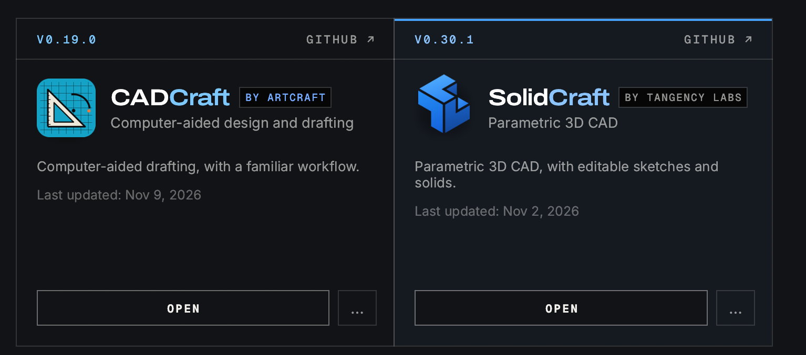

# llm_cad

Exploring ways to let an LLM agent do CAD. The baseline is what we already built with OpenSCAD and an
agent (Claude Code), in two projects:

- [open-mog](https://github.com/falkorichter/open-mog): a fully parametric 1:8 scale RC Unimog
  (portal axles, locking front differential), modelled in OpenSCAD.
- [linear-actuator-crane](https://github.com/falkorichter/linear-actuator-crane): an RC crane driven by
  stepper linear actuators. OpenSCAD CAD with renders and STLs built in CI, plus firmware and PCBs.

The question is whether a parametric B-rep tool driven over MCP (SolidCraft, Onshape) beats writing
`.scad` files: real fillets and chamfers, STEP export, a feature timeline you can edit, and an agent
that can look at what it built.

## Candidates

| Tool | Kind | Agent interface | Status here |
|---|---|---|---|
| OpenSCAD | Code-CAD (CSG mesh, no STEP) | Plain `.scad` files + CLI render | Baseline: open-mog, linear-actuator-crane |
| [SolidCraft](https://github.com/tangency-labs/solidcraft) v0.30.1 (Tangency Labs) | Parametric 3D, B-rep, STEP/STL/3MF | `solidcraft-cli mcp` (stdio) | Registered in `.mcp.json`. Smoke-tested 2026-11-11: the MCP server starts and lists its tools |
| [CADCraft](https://github.com/storytold/cadcraft) v0.19.0 (ArtCraft) | **2D only**: drafting, DXF/DWG, no 3D modelling | `cadcraft-cli mcp` (stdio) | Registered in `.mcp.json`; needs `cadcraft-cli` installed separately: **[install guide](docs/cadcraft-cli-install.md)**. **2D only**, so it's for drawings, not parts |
| Onshape Labs FeatureScript MCP | Cloud parametric (FeatureScript) | Remote MCP over HTTP + OAuth: `https://fs-mcp.labs.onshape.app/mcp` | Registered in `.mcp.json` and authenticated (2026-11-11), 14 tools. See [docs/onshape-mcp/LOG.md](docs/onshape-mcp/LOG.md) |

Both Craft apps were installed through the ArtCraft Launcher. SolidCraft is the 3D one, and CADCraft is **2D only**:



## MCP setup (Claude Code)

`.mcp.json` registers all three servers for this project: two local stdio CLIs and the remote Onshape server. Claude Code asks you to approve them the first
time it starts here; `/mcp` shows their status.

```json
{
  "mcpServers": {
    "solidcraft": {
      "command": "/Applications/SolidCraft.app/Contents/MacOS/solidcraft-cli",
      "args": [
        "mcp",
        "--allow-path",
        "/Users/falkorichter/Documents/workspaces/open_source/llm_cad"
      ]
    },
    "cadcraft": {
      "command": "/Users/falkorichter/.local/bin/cadcraft-cli",
      "args": [
        "mcp"
      ]
    },
    "onshape": {
      "type": "http",
      "url": "https://fs-mcp.labs.onshape.app/mcp"
    }
  }
}
```

| Key | What it does |
|---|---|
| `mcpServers.<name>` | The server's name in Claude Code. Its tools appear as `mcp__solidcraft__*`, `mcp__cadcraft__*` and `mcp__onshape__*`. |
| `onshape` → `type: "http"`, `url` | A remote MCP server (Streamable HTTP), so there's nothing to install. It uses OAuth: the first time, `/mcp` ▸ `onshape` ▸ *Authenticate* opens the Onshape login in the browser. |
| `command` | The program Claude Code starts. It talks MCP over stdio (JSON-RPC on stdin/stdout). |
| `solidcraft` → `command` | The `solidcraft-cli` inside the SolidCraft app bundle, by full path, so nothing else needs installing or adding to `PATH`. |
| `solidcraft` → `--allow-path <dir>` | SolidCraft MCP only reads and writes files in its recovery and temp folders, and the folders of designs it opened or saved. This adds the repo, so the agent can save `.sc`, STEP and STL files here. Change it if you clone the repo somewhere else. `--allow-any-path` lifts the limit entirely. |
| `cadcraft` → `command` | The separately installed `cadcraft-cli` (see below), by absolute path. `${HOME}` did **not** work here: Claude Code reported `ENOENT … posix_spawn '${HOME}/.local/bin/cadcraft-cli'` (2026-11-11). Until the CLI is installed, `/mcp` shows `cadcraft` as failed. |
| `args: ["mcp"]` | Runs the CLI as an MCP server. SolidCraft connects to the running app on its own when "Let AI agents connect" is on, and runs headless otherwise. CADCraft always runs headless unless you add `--connect HOST:PORT`. |

To add an option (for example `--param-check warn` for SolidCraft, or `--connect 127.0.0.1:7979` for
CADCraft), append it to that server's `args`, then restart Claude Code or reconnect via `/mcp`.

### SolidCraft
The macOS app bundle ships `solidcraft-cli`, and `.mcp.json` calls it by its full path. It needs
nothing else.

- By default it runs **headless**, with its own design session.
- To **watch the agent model** in the app, turn on *Preferences ▸ Assistant ▸ Agents through MCP ▸
  "Let AI agents connect"* in SolidCraft. `solidcraft-cli mcp` then connects to the running app on its own.
- Smoke test (2026-11-11): `initialize` + `tools/list` over stdio with `--headless` works. The
  server instructions say to call `skill_reference {"skill":"solidcraft-modeling"}` first for anything
  beyond one primitive. Units are mm and degrees, and Z is up.
- File access is limited (see `--allow-path` above). On startup it prints the allowed folders to stderr.
- Besides MCP, `solidcraft-cli` can also `run` JSON command scripts, `eval` a design and `snapshot` it
  to a PNG, all headless. These are useful for CI, as in linear-actuator-crane's render workflow.
- Young project: first release 2026-10-09, and designs saved in a newer version may not open in older
  ones. Check the version before sharing `.sc` files.
- Docs: https://github.com/tangency-labs/solidcraft/blob/main/docs/mcp.md

### CADCraft (2D only)
> ⚠️ **CADCraft is 2D only.** It's AutoCAD-style 2D drafting (DXF/DWG). Despite the similar name, it isn't
> a 3D CAD tool like SolidCraft: the project's own roadmap gives 3D modelling as 0% (checked v0.19.0,
> 2026-11-11). Use it for drawings, not for modelling 3D-printable parts.

> **Installing `cadcraft-cli`:** see [docs/cadcraft-cli-install.md](docs/cadcraft-cli-install.md). It isn't
> in the app bundle or the launcher, only in the GitHub release assets.

The app bundle (installed via the ArtCraft Launcher) doesn't include `cadcraft-cli`, and the MCP server
needs it. It's published separately in the same GitHub release as the app. The zip below matches the
release's `SHA256SUMS.txt`, and the binary is code-signed (Team ID `DJ6XS33FX8`). Keep the CLI version
the same as the app (check it in the launcher).

```sh
cd "$(mktemp -d)"
curl -LO https://github.com/storytold/cadcraft/releases/download/v0.19.0/cadcraft-cli-0.19.0-macos-universal.zip
shasum -a 256 cadcraft-cli-0.19.0-macos-universal.zip   # expect 6db9565a5fec6bacdfccbf62628a89e4430c9dbb5cc1eb85dbbef71e36e49da9
unzip -q cadcraft-cli-0.19.0-macos-universal.zip
mkdir -p ~/.local/bin && cp cadcraft-cli-0.19.0-macos-universal/cadcraft-cli ~/.local/bin/
```

- Install or upgrade with Ansible: `ansible-playbook -i ansible/inventory.ini ansible/cadcraft-cli.yml`
  (see the [guide](docs/cadcraft-cli-install.md)). Installed 0.19.0 on 2026-11-11.
- Tools (0.19.0, headless): `command_line`, `script`, `execute`, `list_commands`, `inspect_drawing`,
  `query_entities`, `render` (PNG), `find_text`, `new_drawing`, `open`, `save` and `cancel`.
  The project's docs say that bridged to the app it adds `screenshot` and `ui_click` (not tried yet).
- Bridged mode: start the app with `--control 7979` and use `cadcraft-cli mcp --connect 127.0.0.1:7979`.
- Without MCP: `cadcraft-cli run … --export out.png`, `cadcraft-cli info drawing.dxf` and
  `cadcraft-cli convert drawing.dxf drawing.svg`.
- Scope: AutoCAD-style 2D drafting (DXF/DWG, layers, dimensions, hatches, layouts → PDF). The project's
  own roadmap gives 3D modelling as 0%. Use it for dimensioned drawings, PCB/panel outlines or
  laser-cut plates, not 3D parts.

## Onshape Labs FeatureScript MCP

Subscribed on 2026-11-11 (plan: "API limits apply"). **How to use a `.fs` file, with or without the MCP:
[docs/onshape-mcp/HOWTO.md](docs/onshape-mcp/HOWTO.md).** Progress, screenshots and open questions are in
[docs/onshape-mcp/LOG.md](docs/onshape-mcp/LOG.md). Inside Onshape it shows up in the **+** menu, the
context menu ▸ *Applications* and the right panel. Claude Code can also reach it from outside, as a
**remote MCP server**:

- URL: `https://fs-mcp.labs.onshape.app/mcp`, transport **HTTP** (Streamable HTTP)
- Auth: OAuth 2. Without a token the server answers `401` and points to
  `/.well-known/oauth-protected-resource/mcp`. The authorization server is
  `https://mcp-auth.labs.onshape.app`, with scopes `OAuth2Read`, `OAuth2Write`, `OAuth2Delete` and
  `OAuth2ReadPII` (checked 2026-11-11).
- Setup: it's in `.mcp.json` as `"onshape": {"type": "http", "url": "…"}`. Restart Claude Code, then
  `/mcp` ▸ `onshape` ▸ *Authenticate*. Or add it by hand:
  `claude mcp add --transport http --scope project onshape https://fs-mcp.labs.onshape.app/mcp`

## After changing `.mcp.json`

Restart Claude Code in this folder (or reconnect via `/mcp`) and approve the new servers when asked.

## How the tools differ

[docs/featurescript-openscad-solidcraft.md](docs/featurescript-openscad-solidcraft.md): OpenSCAD and FeatureScript are
programs that generate a model; SolidCraft stores a feature tree that the agent built with commands. With
the same first three steps in each.

## Challenges

| # | Challenge | Status |
|---|---|---|
| 01 | [GN container holder](challenges/01-gn-holder/README.md): 3D-printable, parametric holder for gastronorm pans. [Requirements](challenges/01-gn-holder/REQUIREMENTS.md) | v1 (flat frame) built in OpenSCAD, SolidCraft and Onshape FeatureScript, [comparison](challenges/01-gn-holder/LOG.md); v2 (tilted rack) open |

## Next steps

- [x] Install `cadcraft-cli` ([guide](docs/cadcraft-cli-install.md)). Done on 2026-11-11; the stdio MCP check passes.
- [ ] Check that `/mcp` shows both servers connected after a restart.
- [ ] Optional: use CADCraft (2D) for a dimensioned drawing of a finished part, e.g. the GN frame.
- [ ] Rebuild one simple part from open-mog or linear-actuator-crane in SolidCraft via MCP, export
      STEP + STL into this repo, and compare effort, quality and render with the OpenSCAD version.
- [x] Find out how an external client connects to the Onshape MCP: remote HTTP + OAuth (see above).
- [x] Authenticate `onshape` via `/mcp` and list its tools (2026-11-11, 14 tools, see the Onshape log).
- [x] Build challenge 01 v1 with the Onshape MCP (2026-11-11, [notes](challenges/01-gn-holder/onshape/NOTES.md)).
- [x] Insert the "GN Holder" feature into the Part Studio in Onshape and screenshot it (2026-11-11).
- [ ] Export STL/STEP of the Onshape parts into `challenges/01-gn-holder/onshape/`.
- [ ] Save the animated demo GIF from the Onshape App Store page into `docs/onshape-mcp/assets/`.
