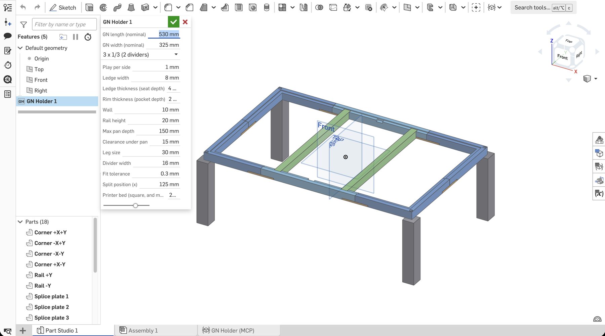

# Challenge 01: GN 1/1 insert frame in Onshape (FeatureScript MCP)

Built 2026-11-11 by Claude Code (Opus 5.5) through the **Onshape Labs FeatureScript MCP**
(`https://fs-mcp.labs.onshape.app/mcp`). Spec: [../DESIGN.md](../DESIGN.md) v1, so it's the same part as
the OpenSCAD and SolidCraft builds.

*2026-11-11, first insert in Part Studio 1 with default parameters (cropped screenshot). Blue: 4 corners +
2 middle rails; green: 2 dividers in the 1/3 seats; orange: splice plates under the joints; grey: legs. The
empty seat at the 1/2 position and the leg-bolt counterbores in the corners are visible on the rails.*

## Where it lives

| What | Where |
|---|---|
| Source (copy in the repo) | [`gn_holder.fs`](gn_holder.fs) |
| Feature Studio in Onshape | Element **"GN Holder (MCP)"** in the challenge document (`did 441c80d4…`, `wid 9c0ab931…`, `eid 2b84907b3b8f3d3b00652434`) |
| The Part Studio it is meant for | `eid 8e498bbfbd31eb26c783ac7d` in the same document |
| Server-side lessons | Onshape document "FeatureScript MCP Notes" (made by `edit_featurescript_notes`) |

**Step-by-step (copy-paste or MCP): [docs/onshape-mcp/HOWTO.md](../../../docs/onshape-mcp/HOWTO.md).** Short version: anyone can paste
`gn_holder.fs` into a Feature Studio; the MCP was only needed to *develop* it (compile, run, check).

**The result is a custom feature, not a model.** The server writes FeatureScript into a Feature Studio
and tests it. It has **no tool to add a feature to your own Part Studio** (`create_geometry` only
writes to a throwaway branch of the server's own working document). The last step is manual:

1. Open the **Part Studio 1** tab (not the Feature Studio tab, which only shows the code).
2. **Search tools…** (Alt/⌥ + C) ▸ type `GN Holder` ▸ click it. This worked first time; no *Commit* in
   the Feature Studio was needed after `put_featurescript`.
3. Press ✓ to accept the defaults.
4. All 18 parts appear, named and coloured. Change any parameter in the feature dialog; everything rebuilds.

STL/STEP export also happens in Onshape itself (right-click ▸ *Export*). The Onshape MCP has no export tool;
see **Export** below for how it was done end to end with Claude in Chrome.

## Approach

One feature `gnHolder` with all DESIGN.md parameters as dialog fields (`gnL`, `gnW`, `play`, `ledgeW`,
`ledgeT`, `rimT`, `wall`, `barH`, `maxDepth`, `clear`, `leg`, `divW`, `tol`, plus `splitX`, `bed`, and a
`layout` enum: 3 × 1/3, 2 × 1/2, 1 × 1/1).

- **Frame** = outer block − rim pocket (`rimT` deep) − through-hole − 6 divider seats − 6 splice recesses −
  24 insert holes − 4 leg sockets − 4 bolt holes with counterbores. Everything from `fCuboid` and
  `fCylinder` plus one `opBoolean` subtraction. The ledge is solid down to the rail bottom (same choice
  as SolidCraft: no supports, stiffer rail).
- **Split** without split planes: the frame is rebuilt once per part and **intersected** with a region box
  (4 corners at |x| ≥ `splitX`, 2 middle rails). This uses CPU time on the server, but not API calls: the whole
  feature is one evaluation.
- **Joints**: same as SolidCraft so the two are comparable. M4 heat-set inserts plus 68 × 18 × 4 splice plates
  recessed into the rail bottom (4 joints across the long rails, 2 across the short ones). Legs have a
  square 8 mm spigot in a socket and one M4 from the top through a Ø8 counterbore.
- **Dividers**: a 16 × 18 bar between the rails with 4 mm end tabs that drop into the seats. The position
  comes from `layout` (an `if` on an enum, which SolidCraft expressions couldn't do).
- **Self-check built into the feature**: for every part it `println`s bbox, volume and bed fit
  (flat / diagonal / NO) and reports a feature warning if a part doesn't fit `bed`. `test_feature`
  returns that console output, so geometry was checked from numbers, without screenshots.

## Part list and checks (test_feature console, default parameters)

| Part | Count | Bbox mm | Volume mm³ | 256 bed |
|---|---|---|---|---|
| Corner (+X+Y, −X+Y, −X−Y, +X−Y) | 4 | 151 × 173.5 × 20 | 98 948.7 | flat |
| Middle rail (+Y, −Y) | 2 | 250 × 18 × 20 | **78 679.0** | flat |
| Splice plate | 6 | 68 × 18 × 4 | 4 641.5 | flat |
| Leg | 4 | 30 × 30 × 172.5 | 148 684.4 | flat (standing) |
| Divider | 2 | 16 × 326.4 × 18 | 90 419.2 | **diagonal** only |

Derived sizes: outer **552 × 347**, opening **532 × 327**, through-hole **516 × 311**, clearance **165** ✓.

**Cross-check with SolidCraft:** the middle rail is 78 679.0 mm³ here and 78 679.3 mm³ in SolidCraft (their
hand calculation: 78 679.0). Corner and divider bboxes are identical. The total is 1 356 578 mm³ vs.
SolidCraft's 1 356 204. The 374 mm³ difference comes from the leg joint, which I sized differently (8 mm
square spigot, 8.6 mm socket, instead of 6 / 6.6).

Not done yet: a parameter sweep (GN 2/3, `max_depth` 100) through `test_feature`. Each run costs
API calls, and you can do it for free in the Onshape dialog.

## Export (2026-11-11, driven by Claude in Chrome)

The Onshape MCP has no export tool, so the export ran through a **second MCP, Claude in Chrome**, which
clicks in the Onshape web UI in your browser:

1. Part Studio tab ▸ right-click ▸ **Export…**
2. **STL**: Binary, Millimeter, Resolution *Fine*, tick **Export unique parts as individual files**, file
   name `gn_holder_onshape_stl` ▸ Export. The zip downloads at once.
3. **STEP**: Format STEP (AP242, *Use latest version*), Millimeter, same tick, file name
   `gn_holder_onshape_step` ▸ Export. **STEP is translated in the background.** Nothing downloads at first;
   the bell shows "Export completed" and the zip arrives about 30 s later.
4. Unzip, rename `Part Studio 1 - Corner +X+Y.stl` → `corner_pxpy.stl` (p/n for +/−), copy into `stl/` and `step/`.

| Files | Count | Note |
|---|---|---|
| [`stl/`](stl/) | 18 (1.7 MB) | "unique parts" still gave **all 18**: identical parts (legs, plates) are not merged |
| [`step/`](step/) | 18 (390 KB) | AP242 Edition 2, exact geometry (e.g. 4 `CYLINDRICAL_SURFACE` = insert holes in a rail) |

**Check of the export against the feature report** (`../openscad/check_stl.py` + exact mesh volumes):
every STL bbox matches (corner 151 × 173.5 × 20, rail 250 × 18 × 20, leg 30 × 30 × 172.5, divider
16 × 326.4 × 18). Volumes: rail 78 679.3, corner 98 949.0, leg 148 684.5 mm³. The total over 18 STLs is
1 356 580.8 vs. 1 356 577.8 in the B-rep report, so tessellation error is +3 mm³ overall. The divider shows "fits: NO"
in `check_stl.py` only because that script checks straight placement; it fits diagonally.

**API cost:** `get_api_usage` went from 36 to 38, which is about what that usage call itself costs. The browser
export goes through the normal web session, not the OAuth app, so it didn't measurably use the allocation.

**Not captured:** the GIF recording of the export (33 frames) said "downloaded" but never arrived in
`~/Downloads`. Probably Chrome blocked a third automatic download from the same page. Next time, export
the GIF before the CAD downloads, or allow multiple downloads for the extension.

## Problems and lessons

1. **`test_feature` gave only "could not find Trojan feature spec: no features found"**, no line number.
   `put_featurescript` wrote the *same* code into the Feature Studio with no errors. A small probe feature
   (same imports, enum, `fCuboid`) passed. After I renamed my helpers from `box`, `cyl`, `lo`, `hi`, `subtract`,
   `dims` to `gnBox`, `gnCyl`, … (and made the comments ASCII-only) it passed. Most likely cause: a name clash
   with the "trojan" no-op feature the tool appends. Lesson: prefix helper names, and when a test gives no
   detail, use `put_featurescript` to a scratch studio to get compile errors.
2. **Lazy queries.** `qCreatedBy(id, BODY)` is evaluated when it's *used*, not when it's written. To name
   "the body just created" I resolve it at once with `qUnion(evaluateQuery(context, q))`. I caught this
   on review before the first run, not from an error.
3. **No route into your own Part Studio.** See above: inserting the feature is a manual click.
4. **API budget.** The plan has 2,500 calls/year, and this build used 36 (about 3 per tool call). The expensive
   part is resending the full ~16 KB source on every test. Batch checks into a single feature run
   (the `println` report) instead of separate calls.

## Effort

- About 20 minutes from "can we build it?" to the feature in the document, about 30 including these notes.
- 11 Onshape tool calls: read notes, version probe, 3 × `test_feature` (1 failed, 1 probe, 1 pass),
  `create_feature_studio`, 2 × `put_featurescript`, `edit_featurescript_notes`, `get_api_usage` (+1 before).
  **36 API requests** in total.
- Corrections: 1 (helper rename after the opaque test error). No geometry fixes: the first successful run
  matched the brief.

## Open issues

- [x] Inserted into Part Studio 1 and checked by eye (2026-11-11, screenshot above). Parts list shows the
  18 named parts, and the feature dialog shows every parameter with its default.
- [x] STL + STEP exported into `stl/` and `step/` (see Export above).
- Same structural concerns as the other two v1 builds: rail sag under a full pan, untested tolerances.
