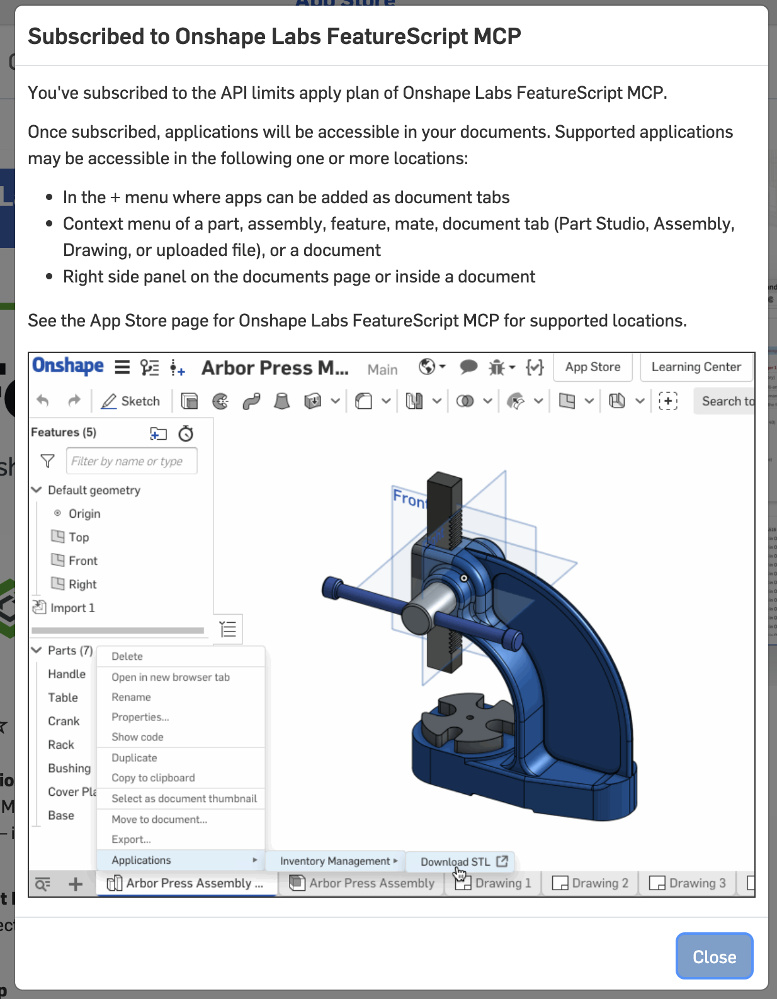
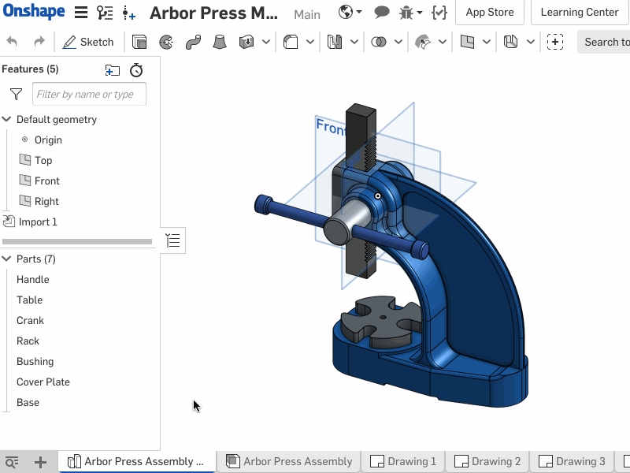
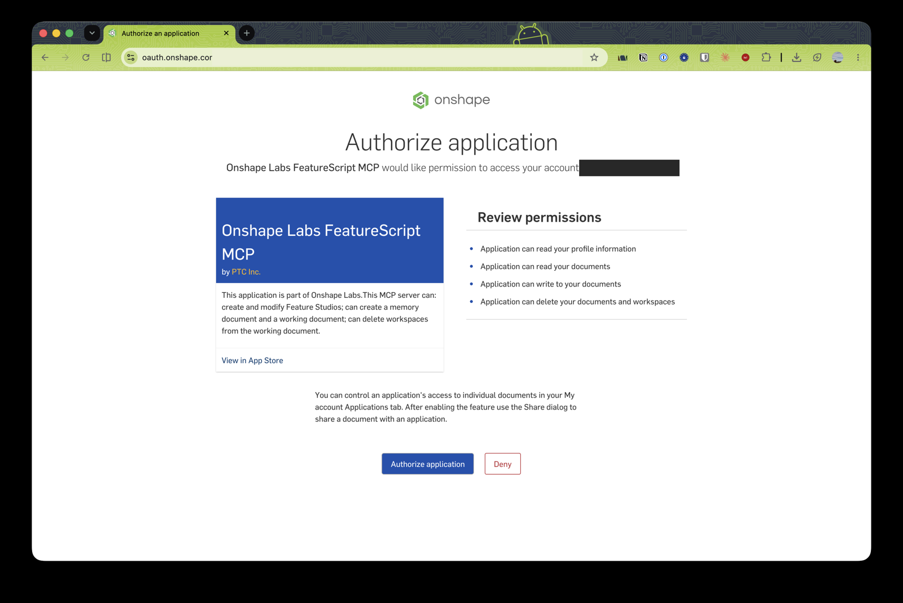
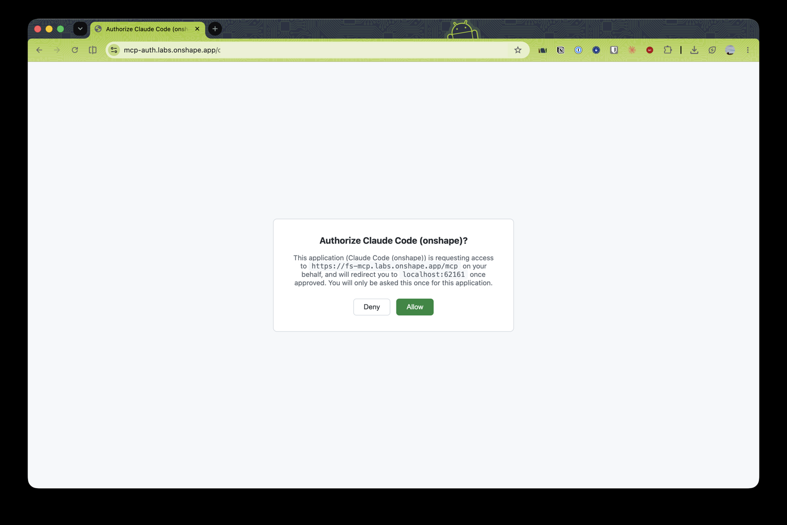
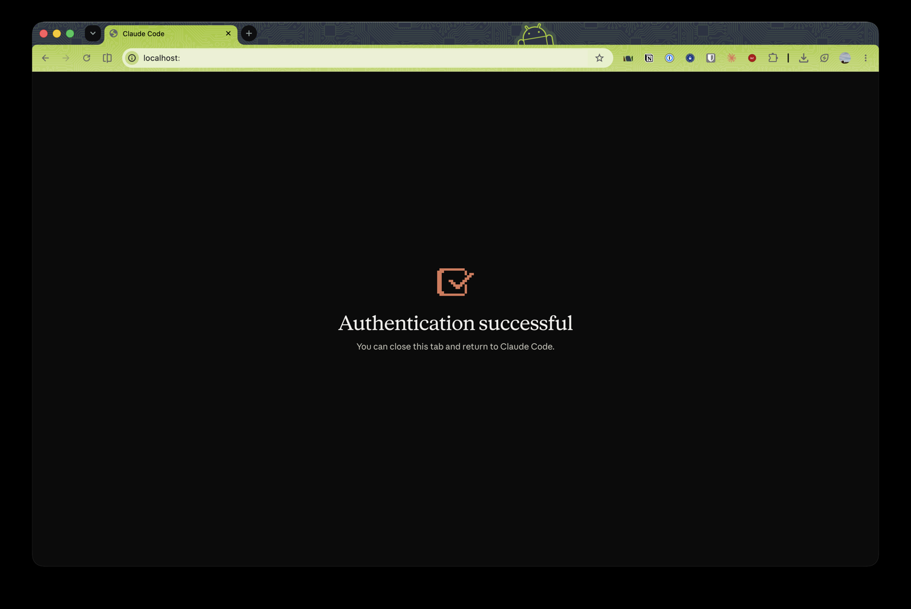

# Onshape Labs FeatureScript MCP: progress log

App Store listing: https://cad.onshape.com/appstore/apps/Onshape%20Labs/6a29aea7c03f8bf659841734

The goal is to see whether an LLM can drive Onshape through FeatureScript well enough to compete with
the OpenSCAD workflow we already use (see [open-mog](https://github.com/falkorichter/open-mog) and
[linear-actuator-crane](https://github.com/falkorichter/linear-actuator-crane)).

## 2026-11-11: subscribed

- Subscribed to **Onshape Labs FeatureScript MCP** on the "API limits apply" plan.
- According to the confirmation dialog, the app shows up in three places:
  - the document's **+** menu, as a new tab
  - the context menu of a part, assembly, feature, mate or tab (*Applications ▸ …*)
  - the right-side panel on the documents page and inside a document

The App Store page has a demo GIF (the Arbor Press sample: right-click a part ▸ Applications ▸ …).
The listing page is rendered client-side, so I couldn't find the GIF's URL to download it. This is a
frame from it:

> TODO: save the animated GIF from the App Store page (right-click ▸ Save image) as
> `assets/2026-11-11-appstore-demo.gif` and replace the frame above.

### Connection details (from the Onshape blog, 2026-11-11)
Source: https://www.onshape.com/en/blog/featurescript-mcp-server-enables-text-code-cad

- Requirements: an Onshape account (signed in) and a subscription to the App Store app ✅ (done).
- **MCP URL: `https://fs-mcp.labs.onshape.app/mcp`**, transport **HTTP**. Works with any MCP client
  (Claude, ChatGPT and Gemini are named).
- What it does: the AI writes **FeatureScript** and inserts it into an Onshape document, then runs it,
  checks the result and fixes errors. The output is a **reusable custom feature** (shows up in the
  toolbar and can be shared), not a one-off model. Once the feature exists, running it costs no AI tokens.
- The blog's example is a parametric roller-chain sprocket. A related blog post covers data safety and
  permissions ("Is CAD Data Safe When AI Connects to Onshape?").
- Added to `.mcp.json` as `onshape` (see 2026-11-11: remote MCP endpoint, below). The command equivalent is
  `claude mcp add --transport http --scope project onshape https://fs-mcp.labs.onshape.app/mcp`.

### Open questions
- [x] How does an external MCP client connect? → remote HTTP MCP, URL above.
- [x] How does auth work in Claude Code? Standard MCP OAuth (see 2026-11-11: remote MCP endpoint).
      Login done 2026-11-11 (three browser steps, see below).
- [x] What do "API limits apply" mean in numbers? → 2,500 calls **per year**, no overage (see 2026-11-11: authenticated).
- [ ] Which tools does it expose? Can it write FeatureScript only, or also read the part studio and
      export STL/STEP?
- [ ] First test: rebuild a simple open-mog or linear-actuator-crane part and compare it with the
      OpenSCAD result (and with the same part built in SolidCraft).

## 2026-11-11: remote MCP endpoint

- URL: `https://fs-mcp.labs.onshape.app/mcp`, transport **HTTP**.
- Unauthenticated `initialize` → `401`, with
  `WWW-Authenticate: Bearer error="invalid_token" … resource_metadata="https://fs-mcp.labs.onshape.app/.well-known/oauth-protected-resource/mcp"`.
  The server is uvicorn, so probably a Python MCP server.
- The protected-resource metadata gives the authorization server `https://mcp-auth.labs.onshape.app`,
  bearer tokens in the header, and the scopes `OAuth2Read`, `OAuth2Write`, `OAuth2Delete` and
  `OAuth2ReadPII`. That's the standard MCP OAuth flow, so Claude Code should handle the login itself.
- Added to `.mcp.json` as `"onshape": {"type": "http", "url": "https://fs-mcp.labs.onshape.app/mcp"}`.
- Gotcha: it didn't show up in `/mcp` at first, because Claude Code reads `.mcp.json` from the
  folder it starts in, and only at startup. The entry was on a branch, not in the checkout in use.
- [x] Next: restart Claude Code, `/mcp` ▸ `onshape` ▸ *Authenticate*, then record the tool list here
      (done, see 2026-11-11: authenticated).

## 2026-11-11: authenticated, tool list

**Gotcha: restart first.** `/mcp` only picked up `onshape` after Claude Code was restarted in the main
checkout (it reads `.mcp.json` once, at startup). After that, `/mcp` ▸ `onshape` ▸ *Authenticate* ran
the whole login and printed `Authentication successful. Connected to onshape.`

The login goes through **two** consent screens, because there are two OAuth layers:

1. **Onshape** (`oauth.onshape.com`): "Onshape Labs FeatureScript MCP by PTC Inc." asks for your
   Onshape account. Permissions: read profile, read documents, **write** documents, **delete**
   documents and workspaces. The card says it can create and modify Feature Studios, create a
   *memory document* and a *working document*, and delete workspaces from the working document.
   You can limit it to single documents later under My account ▸ Applications.

   

2. **The MCP auth server** (`mcp-auth.labs.onshape.app`): "Authorize Claude Code (onshape)?"
   lets Claude Code use `https://fs-mcp.labs.onshape.app/mcp` and redirects to `localhost:<port>`.
   Only asked once per client.

   

3. Claude Code's local callback page: "Authentication successful".

   

(Screenshots: account email and one-time `code`/`state` values blacked out.)

### Tools (14, `mcp__onshape__*`)

Read from the tool schemas, so no API calls spent yet.

| Tool | What it does |
|---|---|
| `whoami` | Which Onshape user/company the session acts as, and whose API allocation is used |
| `get_api_usage` | Used / limit / remaining API calls for the current cycle |
| `set_api_allocation` | Switch between personal and a Pro company's allocation (only on explicit request) |
| `logout` | Sign out (needs `confirm: true`) |
| `search_featurescript_documentation` | Search the FeatureScript docs |
| `read_featurescript_notes` / `edit_featurescript_notes` | A persistent notes file of lessons learned (the "memory document"). The server tells the agent to read it before writing code and add to it after fixing errors |
| `test_featurescript` | Run a FeatureScript **lambda** snippet in a Part Studio. A trivial snippet returns `libraryVersion`, the version to put in the header of new code |
| `test_feature` | Compile + run a full `defineFeature` in a real Feature Studio (via a "trojan" no-op feature) |
| `create_geometry` | Write the feature into a **new branched workspace** and add it to the Part Studio. `clean: true` (default) deletes the branch afterwards. Does **not** return code errors: test first |
| `list_feature_studios` / `get_featurescript` / `create_feature_studio` / `put_featurescript` | Work with Feature Studios in a document you name (`did`, `wid`, `eid`). `put_featurescript` overwrites the whole studio, meant for the final write |

What this answers from the open questions:
- It **writes and tests FeatureScript**; it does not read arbitrary part studios and has **no STL/STEP
  export** tool. Getting a mesh out means exporting in Onshape itself (or via the REST API).
- Feature parameters need **defaults** in `defineFeature(..., { … })`, otherwise "Precondition failed".
- Wrong version header in new code → "no features found". Always ask `test_featurescript` for the
  live version first.

### API allocation

Every tool call (including `whoami`) costs calls from the Onshape API allocation of our plan. When
it's used up, requests fail until the next cycle. `get_api_usage` reports the numbers, which should
answer the open question "what do API limits mean in numbers". Plan: call `get_api_usage` once
before the first real session and log the figures here.

- [x] Run `whoami` + `get_api_usage`, log the allocation numbers (below).

**Numbers (2026-11-11, first two calls):**
- `whoami`: the expected personal account, `consumingFrom: "self"` (personal allocation, no company).
- `get_api_usage`: **2,500 requests per cycle, and the cycle is a whole year**
  (2026-10-12 → 2027-10-12). Overage is **off**, so at 2,500 calls the server simply stops working
  until October 2027. It reported `used: 0` right after the `whoami` call, so either `whoami` is
  free or the counter lags. Check again after the first session.
- That's about 200 calls a month. A FeatureScript session that iterates with `test_feature` can
  easily burn dozens, so: test small snippets, search the docs (also an API call!) sparingly, and log
  `get_api_usage` after each session to learn what a typical part costs.
- [x] First real task: the GN holder as a FeatureScript feature (challenge 01), see 2026-11-11: first build.

## 2026-11-11: how-to, and what the MCP is actually for

- Wrote [HOWTO.md](HOWTO.md): Route A, paste a `.fs` into a Feature Studio (no MCP, no API calls),
  and Route B, the MCP workflow.
- Insight: the finished artifact is a plain `.fs` file. The MCP's value is the agent's **test loop**
  (compile + run + console output in real Onshape, without a human relaying errors), not delivery.

## Next entries

Add dated sections below (`## YYYY-MM-DD: …`), with screenshots in `assets/`.

## 2026-11-11: first build (challenge 01, GN holder)

Full write-up: [challenges/01-gn-holder/onshape/NOTES.md](../../challenges/01-gn-holder/onshape/NOTES.md).

- Workflow that worked: `read_featurescript_notes` → `test_featurescript` (trivial lambda, gives
  `libraryVersion` **3112**) → write the feature locally → `test_feature` until the console report is right →
  `create_feature_studio` + `put_featurescript` into the target document.
- **Gotcha:** `test_feature` answered "could not find Trojan feature spec: no features found" (no line
  number) while `put_featurescript` compiled the same code fine. Renaming generic helper functions
  (`box`, `cyl`, `lo`, …) to prefixed names fixed it.
- **Gotcha:** no tool adds a feature to *your* Part Studio, and there's no render or export. The final
  insert, the visual check and the STL/STEP export are done by hand in Onshape.
- `edit_featurescript_notes` created an Onshape document **"FeatureScript MCP Notes"** in the account, the
  server's "memory document". Lessons from this build are in it.
- Inserting it by hand: Part Studio tab ▸ Search tools (Alt/⌥ + C) ▸ "GN Holder" ▸ ✓. It worked
  first time, without a *Commit* in the Feature Studio.
- Cost: **36 API requests** for 11 tool calls (`get_api_usage` afterwards). 2,464 left until 2027-10-12.
